# SIGE — Diagramas de Secuencia por Módulo
### Sistema Integral de Gestión Escolar

**Versión:** 1.1 | **Estado:** Para revisión del equipo
**Derivado de:** Reglas de Negocio v3 · Especificación de Requisitos v3 · Especificación de API REST v2 · Seguridad y Autenticación v2 · Estrategia de Procesos Programados v2 · Arquitectura C4 v2 · Criterios de Aceptación v2 (CA-057) · Estrategia de Migraciones

---

## 0. Cómo leer este documento

Este documento reúne los diagramas de secuencia que faltaban para los 13 flujos principales de SIGE. Cada diagrama está escrito en **Mermaid** (`sequenceDiagram`) y se acompaña de las reglas y contratos que lo gobiernan.

### 0.1 Convenciones

| Convención | Significado |
|---|---|
| **Roles** | `ADM` Administrador/Directivo · `PRE` Prefecto · `DOC` Docente · `PAD` Personal administrativo · `SL` Solo lectura (matriz RN-AUT-06). |
| **Cliente** | "PWA / Web" es la aplicación Next.js. Toda llamada viaja por HTTPS a través del proxy inverso (Nginx o Caddy); el proxy no se dibuja para no saturar los diagramas. |
| **Validación de acceso** | Toda petición autenticada valida el JWT, carga `USER.role` y `USER.is_active` desde la BD y comprueba que `USER_SESSION.revoked_at` sea nulo (Seguridad §1). En los diagramas aparece como un solo paso: *"Valida JWT, sesión y rol"*. |
| **Errores** | Formato uniforme `{error_code, message, details, rn_reference, trace_id}` (RF-API-04). 401 credenciales o token, 403 rol sin permiso, 404 recurso fuera de alcance, 422 regla de negocio, 429 bloqueo o rate limit. |
| **Resultados no erróneos** | Un escaneo ignorado por rebote, un evento adicional y una reclasificación **no son errores**: se responden con 200 y un campo `result`. |
| **Valores de estado** | Se escriben como en la API: `ASISTIO`, `LLEGO_TARDE`, `FALTO`, `FALTA_JUSTIFICADA`; origen `ESCANEO`, `AUTOMATICO` o `MANUAL`. |
| **Auditoría** | `AUDIT_LOG` es de solo inserción (RN-AUT-05). Los jobs escriben con `user_id = NULL`. |

### 0.2 Índice

| # | Diagrama | Módulo | Reglas principales |
|---|---|---|---|
| 4.1 | Autenticación, renovación de token y bloqueo por intentos fallidos | AUT | RN-AUT-03, RN-AUT-04, RN-AUT-05 |
| 4.2 | Importación masiva de estudiantes | IMP / EST | RN-IMP-01 a RN-IMP-10 |
| 4.3 | Alta manual, edición y registro incompleto de estudiante | EST | RN-EST-02, 03, 10, 11, 13, 14 |
| 4.4 | Generación, revocación y exportación de QR (estudiante y docente) | QR / CRE | RN-QR-01 a RN-QR-06, RN-CRE-01 |
| 4.5 | Escaneo de asistencia estudiantil con reclasificación | AST | RN-AST-01 a RN-AST-09 |
| 4.6 | Verificación automática de ausencias (estudiantes y docentes) | AST / jobs | RN-AST-08, 15, 18, 24; RN-ADM-02 |
| 4.7 | Captura y sincronización offline | AST / MOV | RN-MOV-02, RN-MOV-03, RN-TRX-04 |
| 4.8 | Alta, edición, desactivación y reactivación de la ficha docente | AST (`teachers`) | RN-AST-23, 26 a 30 |
| 4.9 | Registro de asistencia docente (entrada y salida) | AST | RN-AST-10 a 25 |
| 4.10 | Flujo completo de un reporte escolar | REP | RN-REP-01 a RN-REP-09 |
| 4.11 | Envío de comunicación por correo con reintento | COM | RN-COM-01 a RN-COM-04, RN-INF-02 |
| 4.12 | Justificación y modificación de asistencia con auditoría | AST | RN-AST-04, 05, 06, 17, 22 |
| 4.13 | Respaldo y restauración de la base de datos | ADM / `ops` | RN-API-03, RN-INF-03, RF-API-03 |

---

## 4.1 Autenticación, renovación de token y bloqueo por intentos fallidos

**Módulo:** AUT · **Endpoints:** `POST /auth/login/`, `POST /auth/refresh/`, `POST /auth/logout/`, `POST /users/{id}/unlock/`
**Idea central:** access token JWT de 15 minutos (sin estado) + refresh token opaco con estado en `USER_SESSION`, rotado en cada renovación. El bloqueo se cuenta **por nombre de usuario recibido, exista o no**, para no revelar qué cuentas existen.

### 4.1.1 Inicio de sesión y bloqueo por intentos fallidos

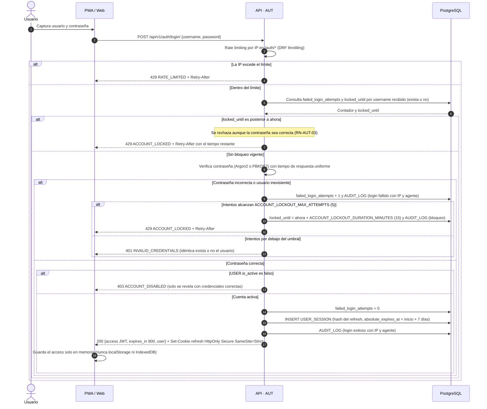

**Reglas y contratos:** RN-AUT-01, RN-AUT-03, RN-AUT-05, RF-AUT-01, RF-AUT-03, SG-01, SG-02. EEl contador se reinicia con un login exitoso, al vencer `locked_until` o por desbloqueo manual. El intento que alcanza el umbral ya responde `429 ACCOUNT_LOCKED` (CA-002-01); los intentos previos responden `401 INVALID_CREDENTIALS`.

### 4.1.2 Uso del access token, renovación con rotación y detección de reutilización

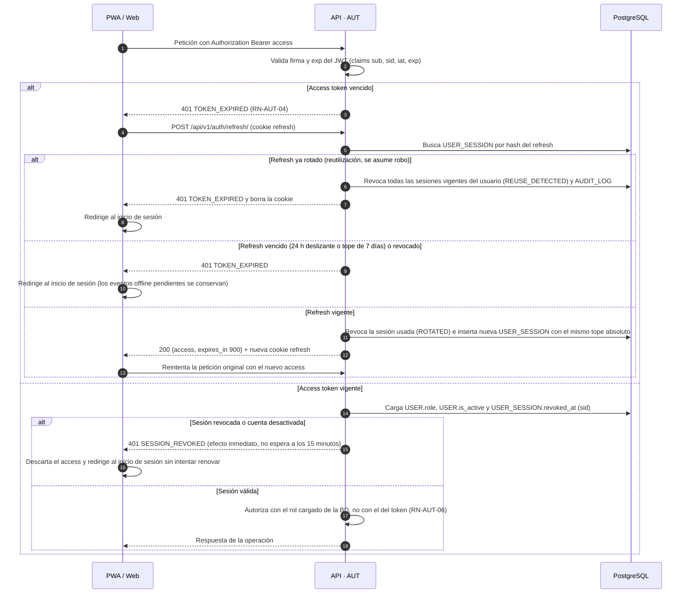

**Reglas y contratos:** RN-AUT-04, RF-AUT-01, US-004, CA-004-07, SG-01, D-08. Las sesiones también se revocan por logout, desactivación de cuenta, restablecimiento de contraseña y cambio de rol.

### 4.1.3 Cierre de sesión y desbloqueo manual por el Administrador

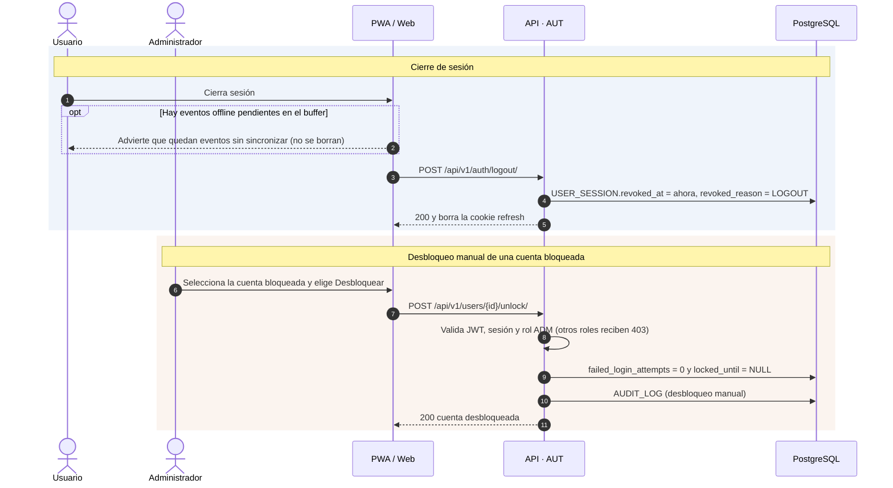

**Reglas y contratos:** RN-AUT-03 (desbloqueo anticipado solo por ADM), CA-001-06. Si quien queda bloqueado es el propio Administrador, el desbloqueo se hace por consola del servidor con `manage.py` (Seguridad §2, punto 8).

---

## 4.2 Importación masiva de estudiantes (versión corregida)

**Módulo:** IMP (delegando la inserción a EST) · **Endpoints:** `GET /imports/template/`, `POST /imports/upload/`, `GET /imports/{batch_id}/`, `POST /imports/{batch_id}/confirm/`, `POST /imports/{batch_id}/cancel/`, `GET /imports/{batch_id}/report/`
**Corrige el Flujo 1 anterior:** toda importación pasa primero por **vista previa sin persistir** (RN-IMP-04); las filas con faltantes diferidos entran como `INCOMPLETO` y las que no traen datos mínimos se descartan (RN-IMP-06); si una matrícula duplicada aparece entre la vista previa y la confirmación, **solo esa fila** se rechaza (RN-IMP-07).

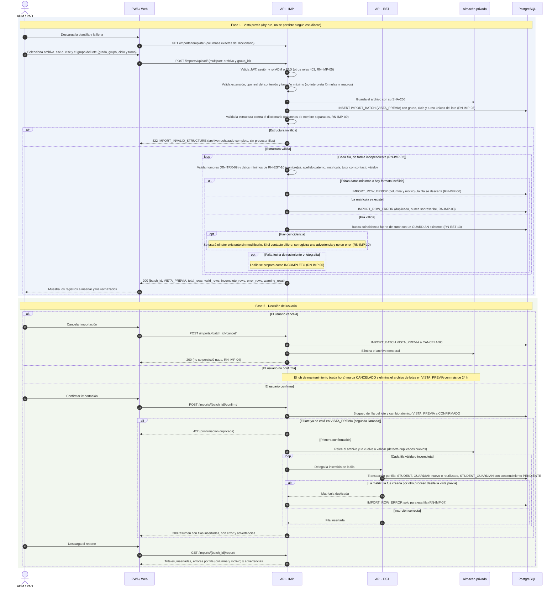

**Reglas y contratos:** RN-IMP-01 a RN-IMP-10, RN-EST-10, RN-EST-13, RN-TRX-09, RF-IMP-01, RF-IMP-02. Una fila fallida nunca detiene al resto del lote. Los archivos contienen datos de menores: viven en el almacén privado y se eliminan según la política de mantenimiento (RN-TRX-01).

---

## 4.3 Alta manual, edición y registro incompleto de estudiante

**Módulo:** EST · **Endpoints:** `POST /students/`, `POST /students/{id}/photo/`, `PATCH /students/{id}/`, `PATCH /guardians/{id}/`
**Idea central:** un estudiante **no se guarda sin un tutor con contacto válido**, pero sí puede guardarse como `INCOMPLETO` si solo faltan la fecha de nacimiento o la fotografía. Los tutores compartidos entre hermanos se reconocen y se actualizan en todos los vínculos con advertencia previa.

### 4.3.1 Alta manual (con reconocimiento de tutor compartido y registro incompleto)

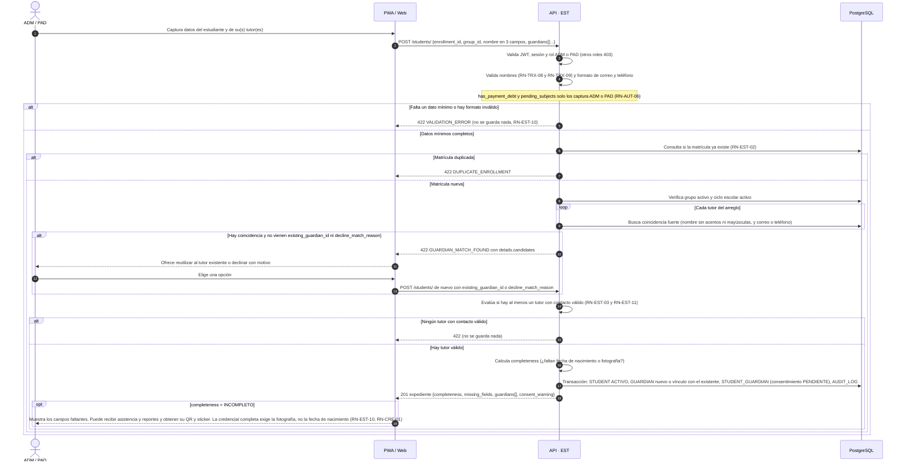

**Reglas y contratos:** RN-EST-02, RN-EST-03, RN-EST-07, RN-EST-10, RN-EST-11, RN-EST-13, RN-TRX-08, RN-TRX-09, RF-EST-01, RF-EST-03. `domicilio`, `sexo` y `CURP` son opcionales y su ausencia no genera la marca `INCOMPLETO`.

### 4.3.2 Completar un registro incompleto

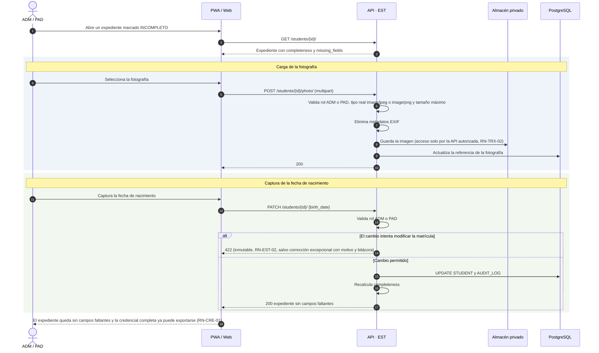

**Reglas y contratos:** RN-EST-02, RN-EST-10, RN-CRE-01, RN-TRX-02. La foto no es pública: se sirve por `GET /students/{id}/photo/` con validación de rol.

### 4.3.3 Edición de un tutor compartido entre hermanos

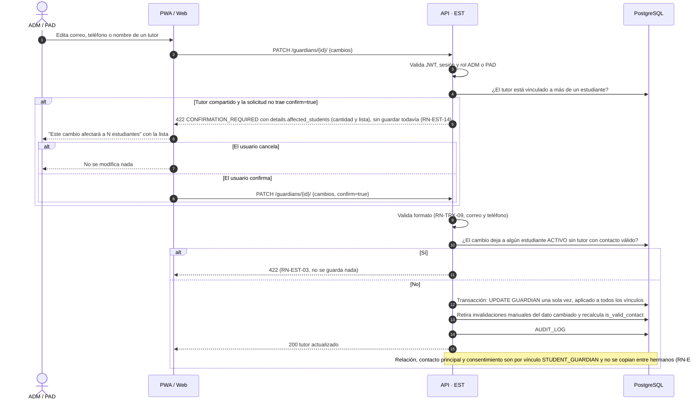

**Reglas y contratos:** RN-EST-11, RN-EST-13, RN-EST-14, RF-EST-07, Modelo de Datos §3.5. Si el reconocimiento fue erróneo, `POST /guardians/{id}/split/` separa al tutor en dos registros sin afectar a los demás estudiantes vinculados.

---

## 4.4 Generación y revocación de QR (estudiante y docente)

**Módulo:** QR/CRE · **Endpoints:** `POST /credentials/tokens/` con `{entity_type: STUDENT | TEACHER, entity_id, reason?}`, `POST /credentials/exports/preview/` y `POST /credentials/exports/`
**Idea central:** el mismo endpoint cubre la **alta inicial** (ADM o PAD, sin `reason`) y el **reemplazo con revocación** (solo ADM, con `reason` obligatorio). El token es un UUIDv4 opaco generado con el CSPRNG del sistema operativo, único contra vigentes **y** revocados, y nunca se reutiliza. Estudiantes y docentes usan tokens independientes.

### 4.4.1 Emisión inicial (alta del QR)

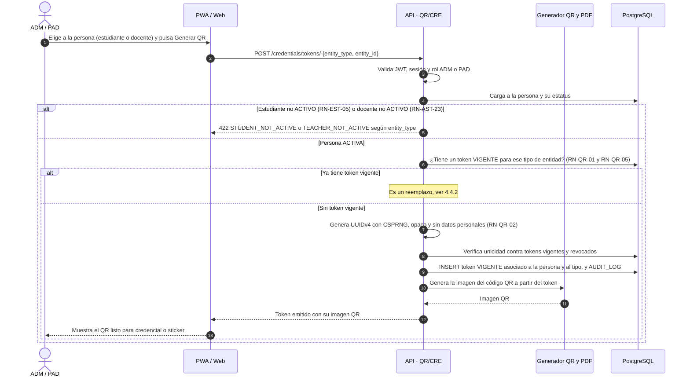

### 4.4.2 Revocación y reemplazo (pérdida, robo, daño o duplicidad)

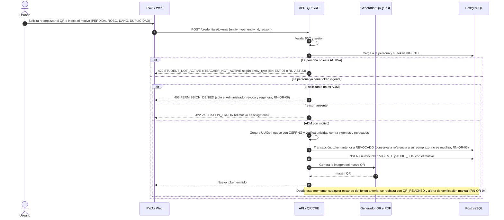

**Reglas y contratos:** RN-QR-01 a RN-QR-06, RN-CRE-01, RF-QR-01, RF-QR-03, RF-QR-04, RNF-SEG-02. Una **baja** de estudiante o la **desactivación** de un docente **no revocan** el QR: los escaneos se rechazan por estatus (RN-EST-04, RN-AST-29) y el QR sigue vigente si la persona se reactiva. La exportación de credenciales completas exige fotografía; el sticker no (RN-CRE-01).

### 4.4.3 Exportación de credenciales y stickers (vista previa y descarga)

**Idea central:** la exportación va en **dos pasos sin estado**. La vista previa lista quién entra y quién queda fuera con su motivo (RN-CRE-01), y la descarga devuelve el archivo directamente. El servidor no guarda copia, porque las credenciales llevan fotografías de menores (RN-TRX-01, RN-TRX-02).

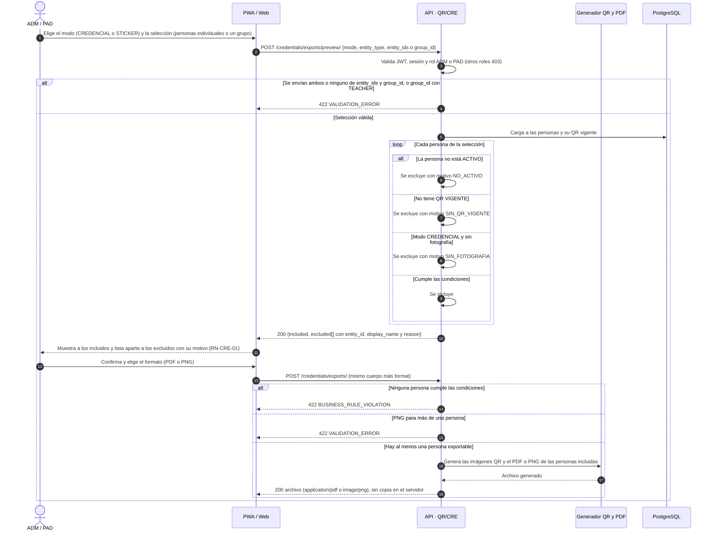

**Reglas y contratos:** RN-CRE-01, RF-CRE-01, RF-CRE-02, RN-AUT-06 (ADM y PAD), RN-TRX-01, RN-TRX-02. Solo se incluyen personas `ACTIVO` con QR `VIGENTE`. Un estudiante `INCOMPLETO` puede exportar sticker; la credencial completa exige fotografía (RN-EST-10, RN-CRE-01). Para reponer un sticker tras una revocación (RF-QR-03) se usa `mode = STICKER` con el `entity_id` de la persona. Hay un máximo configurable de personas por exportación.

---

## 4.5 Escaneo de asistencia estudiantil con reclasificación tras `FALTÓ` automático

**Módulo:** AST (consulta a QR) · **Endpoint:** `POST /attendance/students/scan/` · **Roles:** `PRE`, `PAD`
**Corrige el Flujo 3 anterior:** el rebote se cuenta desde el **último escaneo procesado** (no desde uno ignorado, RN-AST-02/03); el segundo escaneo con estado ya determinado es un **evento adicional** que no cambia el estado (RN-AST-07); y un `FALTO` automático se **reclasifica** por la hora efectiva del escaneo (RN-AST-09). El cliente no envía hora: la hora efectiva es la del servidor (RN-TRX-04).

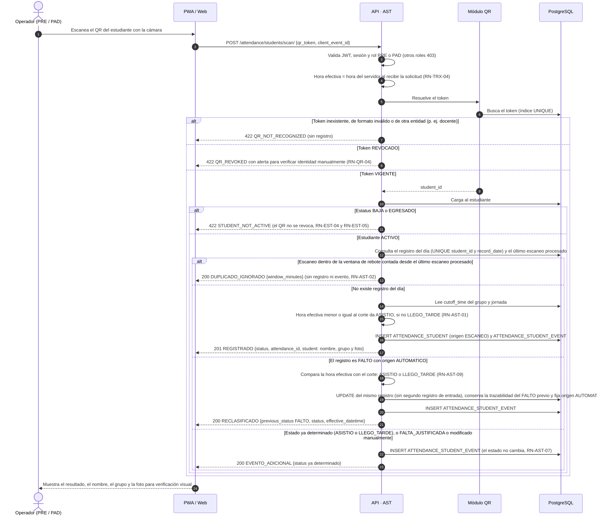

**Reglas y contratos:** RN-QR-04, RN-EST-05, RN-AST-01, RN-AST-02, RN-AST-03, RN-AST-07, RN-AST-09, RN-TRX-04, RN-TRX-07, RN-API-01. Un `FALTA_JUSTIFICADA` o un estado modificado por un usuario **nunca** se reclasifica por escaneo: el estado manual prevalece. La ruta crítica debe resolverse en menos de 250 ms (RNF-DES-01), por lo que correo, auditoría pesada y cualquier trabajo adicional quedan fuera de ella.

---

## 4.6 Verificación automática de ausencias (job programado)

**Módulo:** AST + worker y planificador · **Documento base:** Estrategia de Procesos Programados §1, §2.1, §2.2 y §3
**Idea central:** un **dispatcher** corre cada 5 minutos y encola solo los jobs vencidos y sin corrida registrada hoy. Así sigue los parámetros editables en caliente y recupera corridas perdidas si el servidor estuvo apagado. Todo job es idempotente: marcador `JOB_RUN`, filtro de elegibles y restricción única en la BD.

### 4.6.1 Estudiantes (una vez por turno y día)

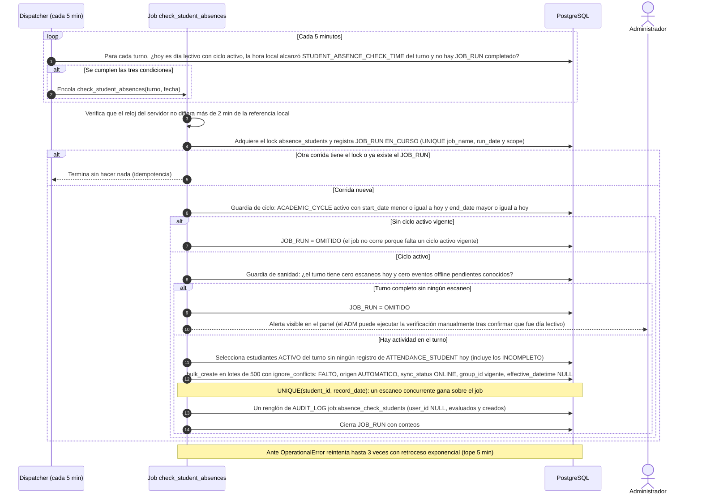

**Reglas y contratos:** RN-AST-08, RN-AST-09, RN-ADM-02, RN-TRX-07, RN-AUT-05, CA-030-01 a 07. Los eventos offline aún no sincronizados **no se esperan**: el estudiante queda `FALTO` y se reclasifica al sincronizar según su hora efectiva (ver 4.7). Quien se da de alta o reingresa después de la hora de verificación no recibe `FALTO` ese día. Los cambios de parámetro no son retroactivos.

### 4.6.2 Docentes (umbral individual por docente)

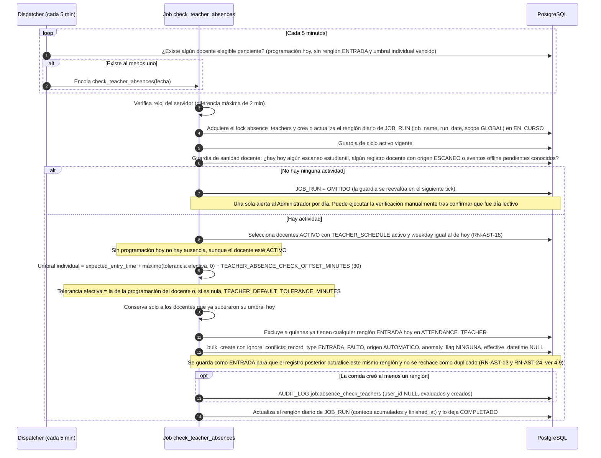

**Reglas y contratos:** RN-AST-13, RN-AST-14, RN-AST-15, RN-AST-18, RN-AST-23, RN-AST-24, RN-AST-29, CA-042-01 a 06. La tolerancia define `LLEGÓ TARDE` al registrar la entrada, **no** interviene en la decisión de `FALTÓ`. Un docente `INACTIVO` no se evalúa. La marca `SALIDA_SIN_ENTRADA` no es responsabilidad de este job: la asigna el endpoint de registro de salida (ver 4.9). El job reutiliza un único renglón diario de `JOB_RUN` (`scope = GLOBAL`) y solo escribe en `AUDIT_LOG` cuando crea al menos un renglón (PP §1 y §2.2, MD §3.16). La guardia de sanidad docente es la de PP §3 (CA-042-08).

---

## 4.7 Captura y sincronización offline

**Módulo:** AST / MOV · **Endpoint:** `POST /attendance/students/sync/` · **Roles:** `PRE`, `PAD`
**Idea central:** sin conexión el dispositivo **no valida nada definitivo**: solo guarda el evento mínimo en un buffer. Todo el criterio de negocio se aplica en el backend al sincronizar, con las mismas reglas que un escaneo en línea (RN-MOV-01, RN-API-01). La hora efectiva sale de la hora de captura corregida con el desfase del reloj, **no** de la hora de sincronización (RN-TRX-04).

### 4.7.1 Captura sin conexión (buffer en el dispositivo)

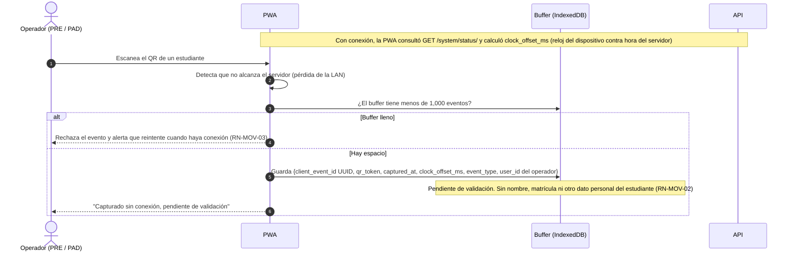

### 4.7.2 Sincronización y validación diferida en el backend

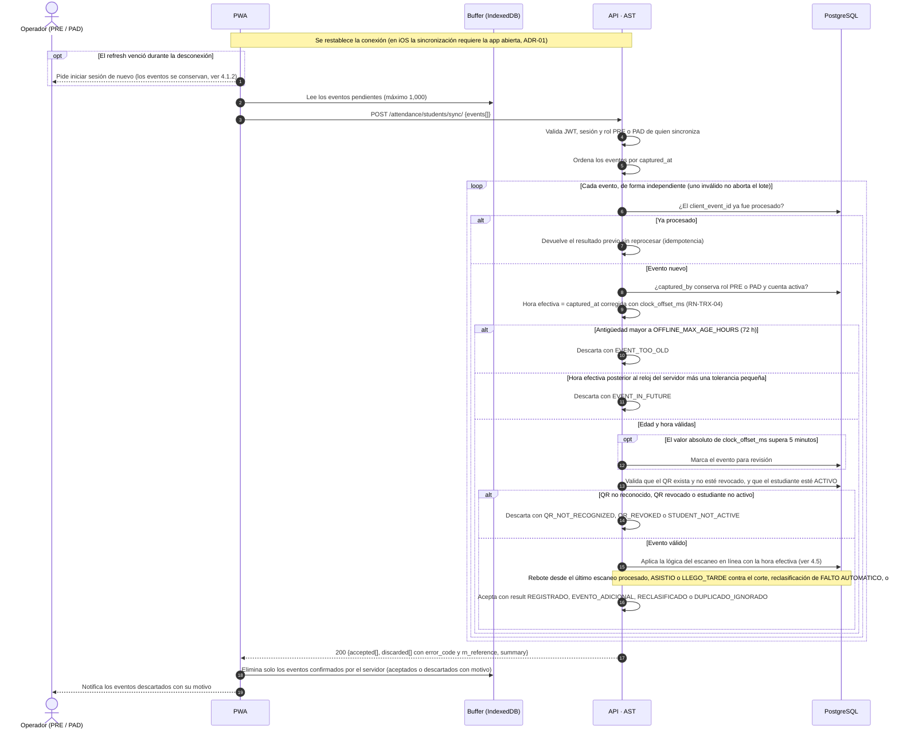

**Reglas y contratos:** RN-MOV-01, RN-MOV-02, RN-MOV-03, RN-TRX-04, RN-AST-02, RN-AST-03, RN-AST-09, RN-API-01, RNF-FIA-01, RNF-FIA-04, SG-09, D-11, US-033. El orden exacto de las validaciones por evento es ilustrativo: los documentos fijan *qué* se valida, no su secuencia interna.
**Caso típico de reclasificación:** un evento capturado a las 07:55 sin conexión y sincronizado a las 11:00, después de que el job de las 10:00 marcó `FALTO`, se acepta como `RECLASIFICADO` con estado `ASISTIO`, porque la hora efectiva (07:55) es anterior al corte (RN-AST-09, RN-TRX-04). Si el registro ya fue `FALTA_JUSTIFICADA` manualmente, el evento solo queda como `EVENTO_ADICIONAL`.

---

## 4.8 Alta, edición, desactivación y reactivación de la ficha docente

**Módulo:** AST (app `teachers`) · **Endpoints:** `POST /teachers/`, `PATCH /teachers/{id}/`, `POST /teachers/{id}/deactivate/`, `POST /teachers/{id}/reactivate/`
**Idea central:** el docente tiene una **ficha propia, independiente de las cuentas de usuario** (RN-AST-23): su asistencia no depende de tener cuenta. Nunca se elimina: solo pasa de `ACTIVO` a `INACTIVO` (ADM o PAD, con motivo) y regresa a `ACTIVO` solo por el Administrador (con motivo).

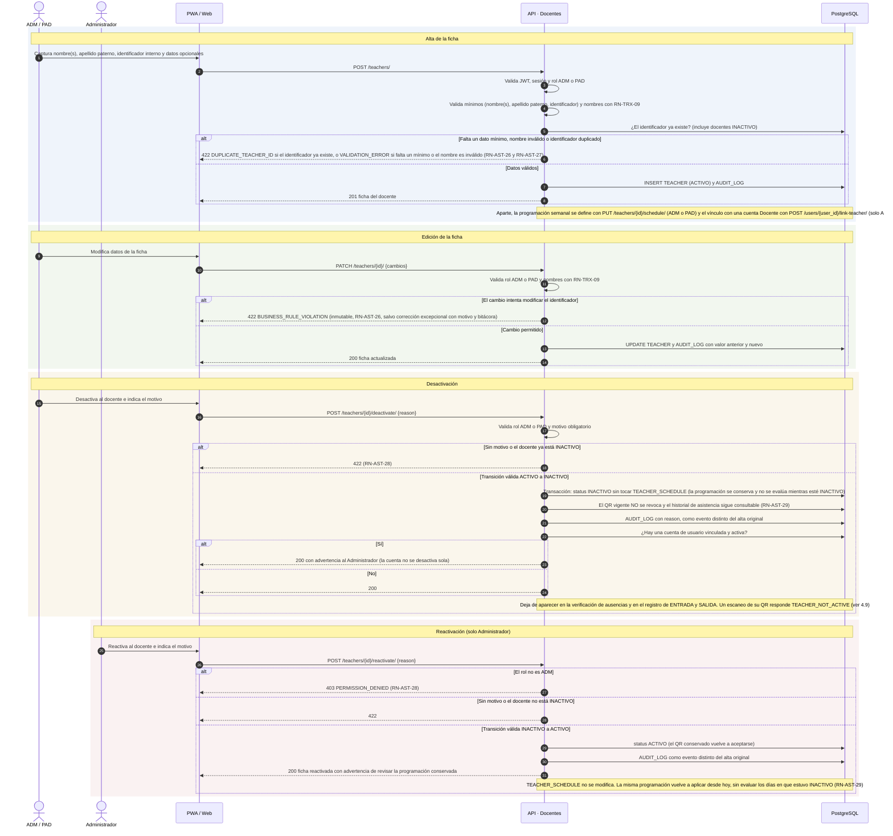

**Reglas y contratos:** RN-AST-23, RN-AST-26 a RN-AST-30, RN-TRX-03, RN-TRX-08, RN-TRX-09, RN-AUT-05, RF-AST-11, RF-AST-12. Datos mínimos: nombre(s), apellido paterno, identificador y estatus. Opcionales: apellido materno, fotografía, correo y teléfono; no generan marca de incompleto (RN-AST-27). Un docente nunca se importa de forma masiva: el alta es individual.

---

## 4.9 Registro de asistencia docente (entrada y salida)

**Módulo:** AST · **Endpoint:** `POST /attendance/teachers/scan/` · **Rol:** solo `PAD` (el Administrador y los demás roles reciben 403, RN-AST-10)
**Idea central:** el Personal administrativo escanea el QR del docente y **elige manualmente** si es `ENTRADA` o `SALIDA` (RN-AST-12). Un `FALTO` automático del día se guarda como `ENTRADA`, por eso la entrada real **actualiza ese mismo renglón** en vez de contarse como duplicada.

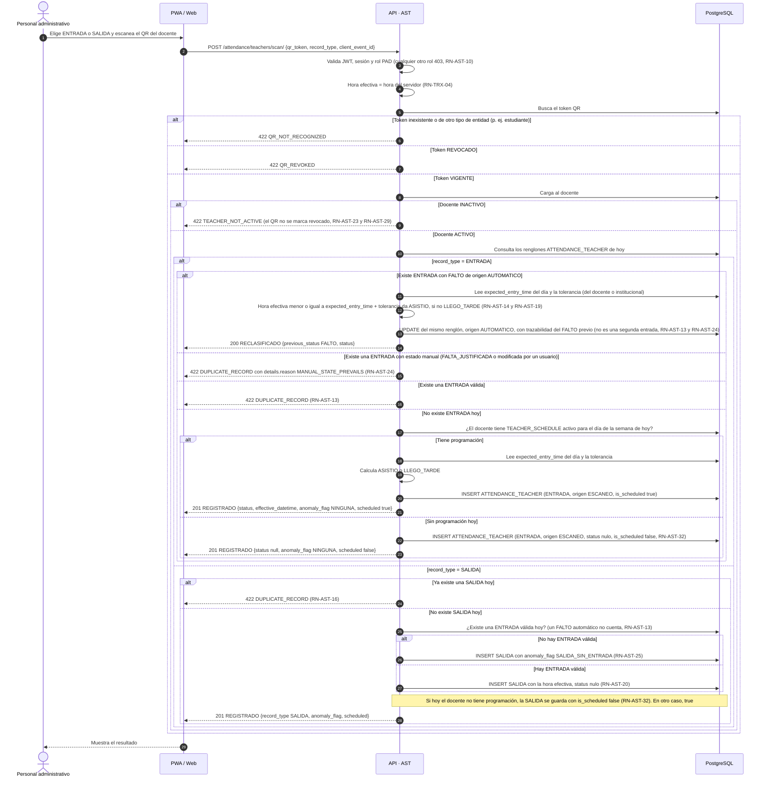

**Reglas y contratos:** RN-AST-10 a RN-AST-25, RN-QR-06, RN-TRX-04, RN-TRX-07, RF-AST-08, RF-AST-09, CA-060-04. La corrección posterior de cualquier registro docente solo procede por el flujo de justificación (ver 4.12). La asistencia del personal administrativo está en espera (RN-AST-31, CC-02): este flujo solo aplica a docentes.

---

## 4.10 Flujo completo de un reporte escolar

**Módulo:** REP (con COM) · **Endpoints:** `POST /reports/`, `POST /reports/{id}/transitions/`, `POST /reports/{id}/communications/`, `GET /reports/{id}/history/`
**Idea central:** el reporte avanza en orden `REGISTRADO → REVISADO_PREFECTO → CANALIZADO → REVISADO_ADMINISTRATIVO → COMUNICADO → RESUELTO` y no puede saltarse etapas (RN-REP-03). Hay dos rechazos distintos: el **rechazo del prefecto** termina el flujo del original (se corrige con un reporte nuevo) y el **rechazo administrativo** devuelve el reporte al prefecto. Nunca se comunica a la familia sin revisión del Personal administrativo (RN-REP-04).

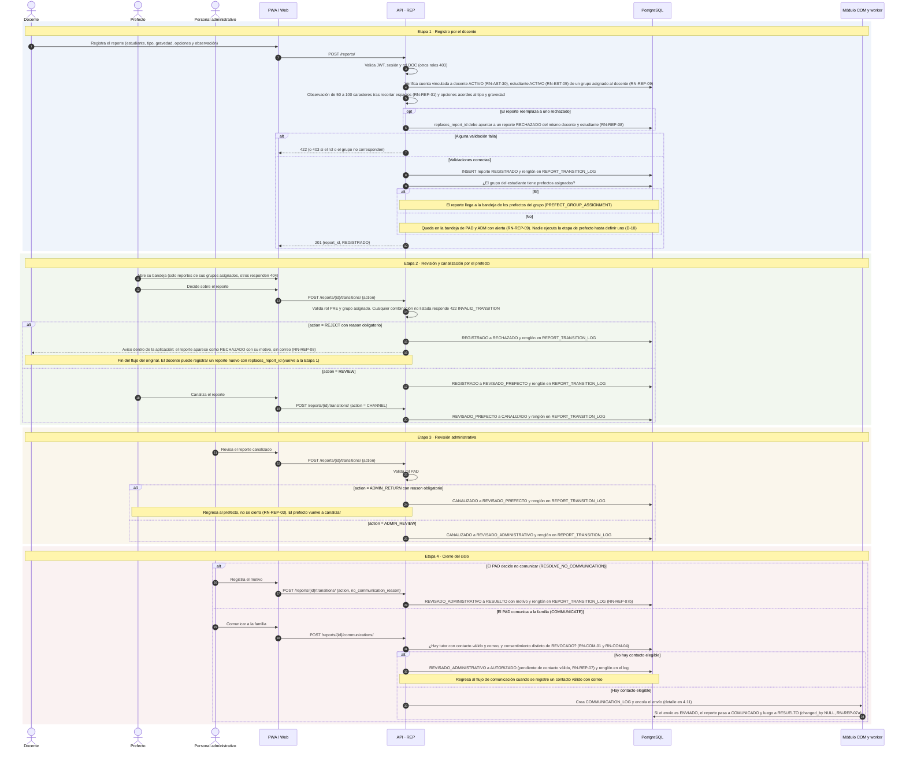

**Reglas y contratos:** RN-REP-01 a RN-REP-09, RN-AST-30, RN-EST-05, RN-COM-01, RN-COM-04, RN-AUT-06, RF-REP-01 a RF-REP-04. Todo cambio de etapa escribe un renglón en `REPORT_TRANSITION_LOG` (RN-REP-06). El tipo y la gravedad no se modifican después del envío (RN-REP-02): no existe `PATCH /reports/{id}/`. Un reporte fuera del alcance del rol responde **404**, no 403 (RN-REP-05). `PRE` y `DOC` nunca autorizan ni comunican (RN-REP-04).

---

## 4.11 Envío de comunicación por correo con reintento

**Módulo:** COM + worker · **Endpoints:** `GET /reports/{id}/communications/preview/`, `POST /reports/{id}/communications/`, `POST /communications/{id}/retry/`, `GET /communications/`
**Idea central:** el envío **nunca** sale del registro del reporte ni de la revisión del prefecto: solo de la acción explícita del PAD (RN-REP-04). Todo intento deja un renglón de estado `PENDIENTE`, `ENVIADO` o `FALLIDO` (RN-COM-03). Sin Internet el correo no sale, pero eso **no afecta** las funciones internas (RN-INF-02).

### 4.11.1 Autorización, envío asíncrono y reintentos automáticos

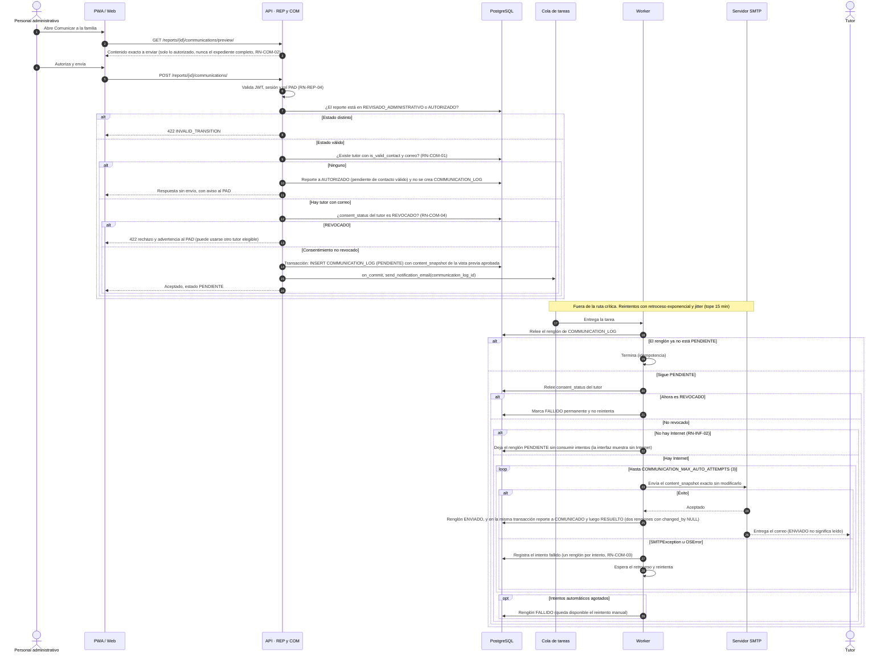

### 4.11.2 Reintento manual y recolector

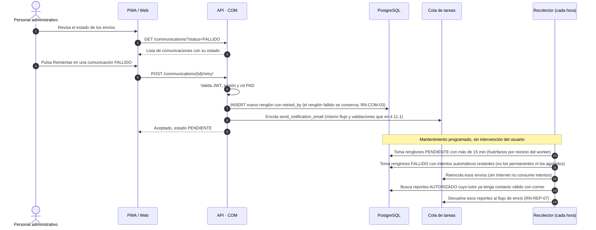

**Reglas y contratos:** RN-COM-01 a RN-COM-04, RN-REP-04, RN-REP-07, RN-INF-02, RN-EST-11, US-050, US-052, US-053, CA-052-*, CA-053-*. Un tutor con solo teléfono es contacto válido para guardar al estudiante, pero **no** puede recibir comunicaciones automatizadas (RN-EST-11). El reintento manual es exclusivo del PAD (D-06 cerrada, RN-AUT-06).

---

## 4.12 Justificación y modificación de asistencia con auditoría

**Módulo:** AST · **Endpoints:** `POST /attendance/students/{attendance_id}/justify/`, `PATCH /attendance/students/{attendance_id}/` y sus equivalentes docentes en `/attendance/teachers/{attendance_id}/`
**Idea central:** solo `ADM` y `PAD` pueden cambiar un registro ya determinado, siempre con **motivo** y con trazabilidad inmutable. Un registro **nunca se elimina**. Solo un `FALTO` puede pasar a `FALTA_JUSTIFICADA`, y el resultado queda con origen `MANUAL`, que prevalece sobre cualquier reclasificación automática.

```mermaid
sequenceDiagram
    autonumber
    actor O as Usuario
    participant W as PWA / Web
    participant A as API · AST
    participant DB as PostgreSQL

    rect rgba(120,160,220,0.12)
    Note over O,DB: Justificar una falta
    O->>W: Selecciona un registro FALTO y captura el motivo
    W->>A: POST /attendance/students/{attendance_id}/justify/ {justification_reason}
    A->>A: Valida JWT, sesión y rol ADM o PAD (RN-AST-04)
    alt El rol es PRE, DOC o SL
        A-->>W: 403 PERMISSION_DENIED
    else Rol autorizado
        alt Motivo ausente
            A-->>W: 422 VALIDATION_ERROR (RN-AST-05)
        else Motivo presente
            A->>DB: Carga el registro
            alt El estado actual no es FALTO
                A-->>W: 422 INVALID_TRANSITION (RN-AST-22)
            else El estado es FALTO
                A->>DB: Transacción: estado a FALTA_JUSTIFICADA con origen MANUAL (el registro no se elimina, RN-AST-06)
                A->>DB: AUDIT_LOG con usuario, fecha y hora, valor anterior, valor nuevo y motivo (RN-AST-05 y RN-AUT-05)
                A-->>W: 200 {attendance_id, FALTA_JUSTIFICADA, MANUAL}
            end
        end
    end
    end

    rect rgba(160,200,140,0.14)
    Note over O,DB: Modificar el estado de un registro ya determinado
    O->>W: Elige el nuevo estado y captura el motivo
    W->>A: PATCH /attendance/students/{attendance_id}/ {status, reason}
    A->>A: Valida rol ADM o PAD y motivo obligatorio
    alt Transición no permitida o motivo ausente
        A-->>W: 422 INVALID_TRANSITION o VALIDATION_ERROR
    else Transición permitida
        A->>DB: UPDATE del estado con origen MANUAL
        A->>DB: AUDIT_LOG con valor anterior, valor nuevo, usuario, fecha y hora, y motivo
        A-->>W: 200 registro actualizado
        Note over A,DB: Un escaneo posterior ya no reclasifica este registro: se guarda solo como EVENTO_ADICIONAL (RN-AST-09 y ver 4.5)
    end
    end

    Note over A,DB: No existe operación de borrado. El rol de BD de la aplicación no tiene DELETE sobre ATTENDANCE_* ni AUDIT_LOG (RN-AST-06, RN-AST-21, RN-TRX-03)
```

**Reglas y contratos:** RN-AST-04, RN-AST-05, RN-AST-06, RN-AST-17, RN-AST-21, RN-AST-22, RN-TRX-07, RN-AUT-05. El flujo docente es equivalente (`/attendance/teachers/{id}/justify/` y `PATCH`), con las mismas reglas de rol, motivo y trazabilidad (RN-AST-17). El contenido de `previous_value` y `new_value` en `AUDIT_LOG` solo lo ve el Administrador (Seguridad §4.4). **Pendiente con la institución:** el conjunto exacto de transiciones permitidas en el `PATCH` (propuesta de la API: cualquier estado a `ASISTIO`, `LLEGO_TARDE` o `FALTO` con motivo, y `FALTA_JUSTIFICADA` solo desde `FALTO`).

---

## 4.13 Respaldo y restauración de la base de datos

**Módulo:** ADM / `ops` + worker · **Endpoint de consulta:** `GET /ops/backups/` (solo ADM) · **Documento base:** Procesos Programados §2.3, CA-057-01 a 05
**Idea central:** el respaldo es **automático y local** (no depende de Internet). El resultado oficial (`status`) es el del respaldo local verificado: la copia externa es opcional, está apagada por defecto y **nunca** modifica `status`. La **restauración no es una API pública**: la ejecuta el Administrador u operador técnico por consola, siguiendo el runbook.

### 4.13.1 Respaldo automático

```mermaid
sequenceDiagram
    autonumber
    participant D as Dispatcher (cada 5 min)
    participant J as Job run_backup
    participant DB as PostgreSQL
    participant V as Volumen local de respaldos
    participant X as Copia externa (opcional)
    actor AD as Administrador

    loop Cada 5 minutos
        D->>DB: ¿El último BACKUP_LOG EXITOSO es más antiguo que BACKUP_FREQUENCY_HOURS (24 h, 02:00 por defecto)?
        alt Vencido (incluye recuperar una corrida perdida porque el servidor estuvo apagado)
            D->>J: Encola run_backup
        end
    end
    J->>DB: pg_dump -Fc
    J->>V: Escribe un archivo temporal en una partición distinta de la de datos
    loop Hasta 3 intentos ante OSError o CalledProcessError (retroceso exponencial, tope 10 min)
        J->>V: Verifica integridad: pg_restore --list y SHA-256
    end
    alt Falla el respaldo o la verificación tras los reintentos
        J->>DB: BACKUP_LOG status FALLIDO
        J-->>AD: Alerta visible en el panel (CA-057-02)
        J-->>AD: Correo adicional, mejor esfuerzo, solo si hay Internet (RN-INF-02)
    else Respaldo verificado
        J->>V: Mueve el archivo al destino final con permisos 0600 y propietario el usuario de servicio
        J->>DB: BACKUP_LOG status EXITOSO, size_bytes y offsite_status N_A
        opt Copia externa habilitada (autorizada por escrito, D-05)
            J->>J: Cifra el archivo antes de salir del servidor
            J->>X: Envía la copia si hay conectividad (hasta 3 reintentos exponenciales)
            J->>DB: Actualiza solo offsite_status (EXITOSO o FALLIDO), nunca status
        end
        J->>V: Rotación: conserva al menos 7 respaldos diarios y 4 semanales, sin eliminar jamás el último EXITOSO verificado
    end
    AD->>DB: Consulta GET /ops/backups/ (fecha, resultado, tamaño y alertas)
```

### 4.13.2 Restauración (procedimiento por consola)

```mermaid
sequenceDiagram
    autonumber
    actor AD as Administrador / operador técnico
    participant C as Consola del servidor
    participant V as Volumen local de respaldos
    participant DB as PostgreSQL
    participant S as Servicios SIGE
    participant L as Bitácora de operación (fuera de la BD)

    Note over AD,S: Se ejecuta según docs/runbook_restauracion.md. No existe API pública de restauración
    AD->>AD: Confirma que la restauración está autorizada (RN-INF-03)
    AD->>V: Elige el último respaldo EXITOSO verificado (BACKUP_LOG o, si la base no responde, el propio volumen)
    AD->>C: Verifica su integridad (SHA-256 y pg_restore --list) antes de tocar nada
    AD->>S: Detiene API, worker/planificador y proxy
    AD->>DB: Conserva la base dañada renombrada hasta validar la recuperada
    AD->>C: Restaura el respaldo en una base limpia
    C->>DB: Recupera esquema y datos
    AD->>DB: Valida conteos de tablas clave, claves foráneas, restricciones únicas, último AUDIT_LOG y acceso del Administrador (CA-057-05)
    AD->>S: Arranca los servicios en el orden PostgreSQL, broker, API, worker/planificador y proxy
    S-->>AD: Sistema operando (se confirma con GET /system/status/)
    AD->>DB: INSERT AUDIT_LOG action ops:restore, origin MANUAL, con reason y detalle en new_value (CA-057-07)
    AD->>L: Registra fecha, respaldo usado, responsable y resultado
    Note over AD,L: Se avisa a los operadores que los datos posteriores al respaldo se perdieron
    Note over S,DB: El dispatcher ejecuta en su primer tick los jobs vencidos. Los eventos offline que sigan en dispositivos se reenvían y se procesan por idempotencia (client_event_id)
```

**Reglas y contratos:** RN-API-03, RN-INF-01, RN-INF-03, RF-API-03, RF-INF-03, RNF-FIA-02, RNF-FIA-03, RNF-SEG-04, KPI-32, CA-057-01 a 05 y CA-057-07. Los respaldos contienen datos de menores: permisos `0600` y copia externa solo cifrada y con autorización institucional. La restauración completa debe probarse antes de cada hito de cierre. **Los pasos de 4.13.2 reflejan el contenido mínimo del runbook** (PP §2.3); los comandos exactos viven en `docs/runbook_restauracion.md`.

---

## 5. Registro de observaciones y su resolución

Las 14 observaciones detectadas al construir estos diagramas quedaron resueltas por el paquete de parches PAQ1 (`SIGE_Parches_Observaciones_Diagramas_v1.md`) y por los cambios del Modelo de Datos v3.2. Esta tabla se conserva como registro de trazabilidad.

| # | Observación | Resolución | Dónde |
|---|---|---|---|
| 1 | QR revocado docente: `QR_NOT_RECOGNIZED` frente a `QR_REVOKED` | Se usa `QR_REVOKED` para tokens `REVOCADO` | PO-01 |
| 2 | Quinto intento fallido de login | El intento que alcanza el umbral responde `429 ACCOUNT_LOCKED` | PO-02 |
| 3 | Respuesta con sesión revocada o cuenta desactivada | `401 SESSION_REVOKED`, sin intento de renovación | PO-03, PT-01 |
| 4 | `ENTRADA` docente con `FALTA_JUSTIFICADA` manual | `422 DUPLICATE_RECORD` con `details.reason = MANUAL_STATE_PREVAILS` | PO-04 |
| 5 | `ENTRADA` o `SALIDA` en un día sin programación | Se guarda con `status` nulo e `is_scheduled = false` (RN-AST-32) | PO-05, MD-03 |
| 6 | Programación al reactivar un docente | Se conserva sin tocarse y vuelve a aplicar desde la reactivación | PO-06, MD-04 |
| 7 | `JOB_RUN` y el job docente | Un único renglón diario `GLOBAL` que se actualiza | PO-07, FE-2, MD-06 |
| 8 | Guardia de sanidad docente | Guardia basada en actividad de asistencia, con una alerta por día | PO-08 |
| 9 | Exportación de credenciales | Vista previa y exportación sin estado | PO-09 |
| 10 | Orden de arranque del servidor | PostgreSQL, broker, API, worker/planificador y proxy | PO-10 |
| 11 | Permisos de reintento de correo | Solo PAD (D-06 cerrada) | PO-11 |
| 12 | Canal de la notificación de rechazo | Aviso dentro de la aplicación, sin correo | PO-12 |
| 13 | Códigos de error sin catalogar | `DUPLICATE_TEACHER_ID`, `CONFIRMATION_REQUIRED`, `STUDENT_NOT_ACTIVE` y `TEACHER_NOT_ACTIVE` según `entity_type` | PT-01, PO-13 |
| 14 | Pasos de restauración | Contenido mínimo del runbook en nueve puntos | PO-14 |

---
