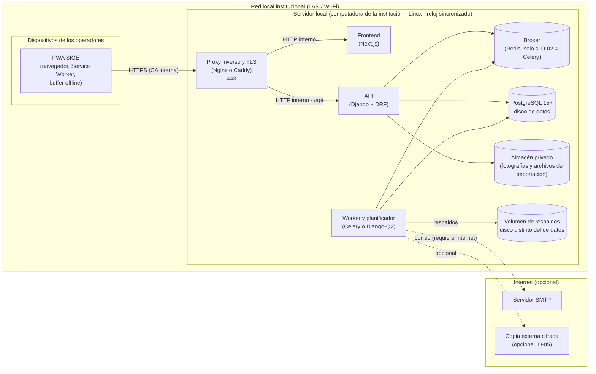

# SIGE — Plan de Despliegue
### Sistema Integral de Gestión Escolar

**Archivo:** `SIGE_Plan_de_Despliegue_v1.md`
**Versión:** 1.0 | **Estado:** Borrador, por validar en la primera instalación en preproducción (Hito 05)
**Fuentes:** Acta Constitutiva v10 (OE-11, §6.9, Hito 05) · Requisitos v3 (RF-INF-01 a 03, RNF-FIA-02 a 04, RNF-POR-01, RNF-SEG-01, RNF-MAN-01) · Arquitectura C4 v2 (§5 despliegue) · Seguridad y Autenticación v2 (§5, §8) · Procesos Programados v2 (§2.3, §3) · Estrategia de Migraciones · Modelo de Datos v3.2 · `runbook_restauracion.md` v0.1 · Arquitectura Frontend y PWA v1

---

## 0. Cómo leer este documento

1. **Qué cubre.** Instalación del servidor local, contenedores, puesta en marcha, operación diaria, actualizaciones y **recuperación ante fallo** (RF-INF-03). La restauración de la base de datos paso a paso vive en `runbook_restauracion.md`; este plan lo referencia y lo completa.
2. **Qué está fijado y qué propongo.** Los requisitos y la arquitectura de despliegue vienen de los documentos del proyecto. **Los contenedores, el dimensionamiento, el sistema operativo, el procedimiento de entrega sin Internet y los detalles de configuración son propuestas mías** y llevan la marca **(Propuesta)**; están reunidas en el §9. Los documentos no las fijan: C4 dice "Linux" y "PostgreSQL 15+", y deja abiertos Nginx o Caddy y Celery o Django-Q2 (D-02).
3. **Los comandos son plantillas** y todavía no se han ejecutado en el servidor real. Los valores entre ⟦dobles corchetes⟧ se completan al desplegar. La primera instalación en preproducción valida este documento.
4. **Sin Internet es el caso normal.** Todo el procedimiento debe poder hacerse sin Internet (RN-INF-01, RNF-POR-01). Internet solo se usa para correo y, si se autoriza, copia externa de respaldos.

---

## 1. Alcance y decisiones de despliegue

### 1.1 Alcance

| Dentro | Fuera |
|---|---|
| Un **servidor local** en una computadora de la institución (RF-INF-01) | Acceso remoto desde Internet (Acta: fuera de alcance en esta fase) |
| Servicios del sistema: proxy con TLS, frontend, API, base de datos, worker y planificador, volumen de respaldos | Alta disponibilidad con varios servidores |
| Dispositivos de los operadores en la red local (PWA) | Administración de los dispositivos personales de los operadores |
| Instalación, puesta en marcha, actualización, monitoreo básico y recuperación | Monitoreo avanzado o centralizado |
| Reproducir el servidor en un equipo de reemplazo (RNF-POR-01) | |

### 1.2 Decisiones propuestas

| # | Decisión | Propuesta | Alternativa |
|---|---|---|---|
| **D-DEP-01** | **Contenedores** | **Sí: Docker Compose** para todos los servicios, incluida PostgreSQL con su volumen de datos en un disco dedicado. Una sola descripción reproducible del servidor sirve a RNF-POR-01 y reduce las diferencias entre la preproducción y la producción | Instalación nativa con `systemd`. Menos piezas para el equipo de la institución, pero más fácil que dos equipos queden distintos. El plan incluye la tabla de equivalencias (§7.4) para cualquiera de las dos |
| **D-DEP-02** | **Entrega sin Internet** | Paquete de entrega firmado con las imágenes exportadas, el archivo de composición, el ejemplo de variables de entorno y las sumas de verificación, transportado por memoria USB (§4) | Registro de imágenes local en la LAN (más complejo; solo si hay varias instalaciones) |
| **D-DEP-03** | **Servidor encendido** | Encendido de forma continua, o programado para despertar antes de la jornada y antes del respaldo de las 02:00 | Apagado cada noche: el dispatcher recupera los jobs vencidos en el primer arranque (PP §3), pero el respaldo se retrasa hasta ese momento |
| **D-DEP-04** | **Sistema operativo** | Una versión **LTS** de Linux de amplio soporte, con actualizaciones de seguridad programadas | Otra distribución que el equipo domine mejor |

> La decisión **D-02** (Celery con Redis, o Django-Q2 con broker en la base de datos) sigue abierta y debía marcarse **antes del Hito 03**. Cambia un servicio (Redis) y la forma de los locks. Este plan se escribe para ambas variantes y marca la diferencia donde importa.

---

## 2. Arquitectura de despliegue

### 2.1 Vista general

Basada en el diagrama de despliegue de C4 §5. Todos los servicios corren en una sola computadora; solo el proxy escucha en la red.



### 2.2 Servicios, puertos y exposición

| Servicio | Imagen o paquete | Puerto | ¿Expuesto a la LAN? | Notas |
|---|---|---|---|---|
| `proxy` | Nginx o Caddy | **443** | **Sí, es el único** | TLS con certificado de la CA interna. Aplica las cabeceras de SEG §5 |
| `web` | Next.js (salida *standalone*) | 3000 | No | Solo el proxy lo alcanza |
| `api` | Django con un servidor WSGI/ASGI | 8000 | No | Incluye generación de QR y PDF (no es un contenedor aparte, C4) |
| `worker` | Misma imagen de la API | — | No | Ausencias, respaldos, cola de correos y mantenimiento. Monta el volumen de respaldos |
| `redis` | Redis | 6379 | No | **Solo si D-02 = Celery** |
| `db` | PostgreSQL 15+ | 5432 | No | Volumen de datos en un disco dedicado |

SEG §5 exige que PostgreSQL, Redis y el servidor de aplicación escuchen solo en la propia máquina y que el firewall permita únicamente el 443 desde la LAN. En contenedores se cumple **no publicando** esos puertos en el equipo anfitrión: viven en una red interna de composición.

### 2.3 Volúmenes

| Volumen | Contiene | Ubicación | Permisos | Notas |
|---|---|---|---|---|
| Datos de PostgreSQL | Base de datos | Disco de datos | Propietario del contenedor de la base | |
| Almacén privado | Fotografías de estudiantes y archivos de importación | Disco de datos | `0700`, propietario el usuario de servicio | Datos de menores (RN-TRX-01, RN-TRX-02) |
| **Respaldos** | Volcados verificados | **Disco o partición distinta del de datos** (R-14) | `0600` para cada archivo | Obligatorio, no depende de Internet (PP §2.3) |
| Secretos y TLS | Archivo de entorno, certificado del servidor y llave | Directorio de configuración | `0600`, propiedad del usuario de servicio | SEG §8. Nunca en el repositorio Git |

---

## 3. Requisitos del servidor

### 3.1 Computadora y sistema operativo

Los documentos solo dicen "una computadora proporcionada por la institución" con Linux. Los valores siguientes son **propuestas de arranque**, por validar con la matrícula real y con una prueba de carga en preproducción (RNF-DES-02):

| Aspecto | Mínimo propuesto | Recomendado | Por qué |
|---|---|---|---|
| Procesador | 4 núcleos de 64 bits | 4 a 8 núcleos | API, worker, base de datos y generación de PDF concurrentes en hora pico |
| Memoria | 8 GB | 16 GB | PostgreSQL, API, Next.js, worker y caché |
| Disco de datos | SSD de 256 GB | SSD de 512 GB | Base, fotografías y archivos temporales |
| **Disco de respaldos** | Disco o partición **distinta**, de al menos 5 veces el tamaño de la base | Disco físico distinto | Rotación de 7 diarios y 4 semanales (PP §2.3) |
| Red | Puerto Ethernet, **IP fija o reservada** | Ethernet (no Wi-Fi) | Los dispositivos deben encontrar siempre el mismo servidor |
| Energía | **No-break (UPS)** con apagado ordenado | UPS con aviso al sistema | Un corte de energía durante una escritura es el riesgo principal para la base |
| Sistema operativo | Linux de soporte largo (D-DEP-04) | | C4 §5 |

### 3.2 Red y nombre del servidor

- **IP fija o reservada** en el router de la institución, y un nombre interno que el router o el servicio de nombres local resuelva. Documentar ambos.
- El certificado del servidor incluye **el nombre y la IP** como nombres alternativos, de modo que los dispositivos funcionen con cualquiera de los dos.
- Los dispositivos y el servidor están en la misma red local; no hace falta abrir puertos a Internet.
- Verificar con la matriz de dispositivos (RNF-COM-02) que el nombre elegido se resuelve en todos los modelos de teléfono soportados.

### 3.3 Hora y zona horaria

- Zona horaria **institucional** en el sistema operativo, en `TIME_ZONE` de Django y en el planificador, con `USE_TZ=True` (PP §3, punto 4).
- Sincronización con `chrony`. **Sin Internet** se usa el procedimiento manual del §6.4 (RNF-FIA-04).

### 3.4 Seguridad del equipo (SEG §8)

- **Usuario del sistema dedicado** para SIGE, sin privilegios de administrador.
- **Acceso físico y de consola restringido** al equipo técnico y al Administrador.
- **Firewall:** solo se permite el 443 desde la LAN. El acceso de administración por SSH, si se usa, es solo desde la LAN, con llaves y sin contraseña **(Propuesta)**.
- **Actualizaciones de seguridad** del sistema operativo programadas (§6.2).
- `DEBUG=False`; secretos en archivo de entorno con permisos `0600` fuera del repositorio.

---

## 4. Artefactos y entrega sin Internet **(Propuesta)**

### 4.1 Qué se entrega

Un **paquete de entrega** por versión, armado por la integración continua y probado en preproducción antes de llevarlo a la institución:

| Contenido | Descripción |
|---|---|
| Imágenes de contenedor | `api`, `web` y las de terceros fijadas por versión exacta (base de datos, proxy, y Redis si aplica), exportadas a archivos |
| `docker-compose.yml` | Descripción de los servicios, redes y volúmenes (§5.4) |
| `.env.example` | Lista de variables sin valores secretos (§5.3) |
| Scripts de instalación y de actualización | Los pasos del §5 y del §6.2 en forma ejecutable |
| `SHA256SUMS` y su firma | Sumas de verificación de todos los archivos |
| Notas de la versión | Cambios, migraciones, y si alguna es **irreversible** (MIG §6) |
| Documentación | Este plan, `runbook_restauracion.md` y la guía de operación |

### 4.2 Versionado

- Versión semántica (`mayor.menor.parche`) más el identificador de compilación; el mismo identificador se usa en el Service Worker de la PWA (Arquitectura Frontend §5.3.3).
- Se **conservan las dos versiones anteriores** en el servidor para poder volver atrás (§6.2).
- Una versión que cambia el esquema indica en sus notas la **migración** y si tiene vuelta atrás.

### 4.3 Verificación de la entrega

Antes de instalar: comprobar `SHA256SUMS` contra su firma y contra el contenido de la memoria USB. Un archivo que no coincide **no se instala**.

---

## 5. Instalación inicial del servidor

Cada paso termina con una verificación. Si una verificación falla, no se continúa.

### 5.1 Preparar el equipo

1. Instalar el sistema operativo (D-DEP-04) y aplicar las actualizaciones disponibles.
2. Configurar la **zona horaria institucional** y `chrony` (§3.3). Verificar: `timedatectl` muestra la zona y el reloj sincronizado, o la hora ajustada a mano.
3. Crear el **usuario de servicio** `⟦sige⟧` sin privilegios de administrador.
4. Preparar los discos:

```bash
# Ejemplo: un disco de datos y otro de respaldos, ya montados
sudo mkdir -p ⟦/srv/sige/data⟧ ⟦/srv/sige/backups⟧ ⟦/srv/sige/config⟧
sudo chown -R ⟦sige⟧:⟦sige⟧ ⟦/srv/sige⟧
sudo chmod 700 ⟦/srv/sige/data⟧ ⟦/srv/sige/config⟧
sudo chmod 700 ⟦/srv/sige/backups⟧
findmnt ⟦/srv/sige/data⟧ ⟦/srv/sige/backups⟧      # comprobar que son dispositivos distintos
```

   Verificar que `data` y `backups` están en **discos o particiones distintos** (R-14).
5. Configurar el **firewall** para permitir solo el 443 desde la LAN (y, si se usa, el SSH desde la LAN).

### 5.2 Instalar el motor de contenedores

Si hay Internet durante la instalación se puede usar el repositorio oficial del sistema; si no, el paquete de entrega trae los instaladores. Verificar con `docker --version` y `docker compose version`. El usuario de servicio puede ejecutar los contenedores; los demás usuarios no.

### 5.3 Configuración y secretos

Crear `⟦/srv/sige/config/.env⟧` con permisos `0600` y propietario el usuario de servicio (SEG §8). **No** se guarda en Git. Variables (nombres; los valores se generan en cada instalación):

| Variable | Contenido |
|---|---|
| `DEBUG` | `False` |
| `SECRET_KEY` | Clave de Django generada al azar |
| `JWT_SIGNING_KEY` | Llave de firma de los access tokens |
| `ALLOWED_HOSTS` | El nombre interno y la IP del servidor |
| `TIME_ZONE` | Zona horaria institucional |
| `POSTGRES_PASSWORD`, `DB_OWNER_PASSWORD`, `DB_APP_PASSWORD` | Claves de los roles de la base |
| `DB_NAME`, `DB_OWNER`, `DB_APP_ROLE` | Nombres de la base y de los roles |
| `BACKUP_DIR` | Ruta del volumen de respaldos dentro del contenedor |
| `SMTP_HOST`, `SMTP_PORT`, `SMTP_USER`, `SMTP_PASSWORD` | Correo saliente (opcional; sin él, los envíos quedan `PENDIENTE`) |
| `REDIS_URL` | Solo si D-02 = Celery |

**Cómo regenerar secretos** (SEG §8 exige documentarlo en cada despliegue):

| Secreto | Efecto de cambiarlo | Cómo |
|---|---|---|
| `SECRET_KEY` y `JWT_SIGNING_KEY` | Todas las sesiones se invalidan; los usuarios inician sesión de nuevo | Generar un valor nuevo, actualizar el archivo y reiniciar `api` y `worker` |
| Clave de un rol de la base | Hay que cambiarla también en PostgreSQL | `ALTER ROLE` con la clave nueva y actualizar el archivo |
| Credenciales SMTP | Los envíos usan el proveedor con las claves nuevas | Obtenerlas del proveedor y reiniciar `worker` |

### 5.4 Descripción de los servicios (ilustrativa)

```yaml
# docker-compose.yml  (versiones, nombres y rutas: a fijar al desplegar)
services:
  db:
    image: postgres:⟦15.x fijada⟧
    restart: unless-stopped
    env_file: ⟦/srv/sige/config/.env⟧
    volumes:
      - ⟦/srv/sige/data/postgres⟧:/var/lib/postgresql/data
      - ⟦/srv/sige/backups⟧:/backups:ro          # solo lectura: para la restauración
    networks: [interna]                            # sin puertos publicados
    healthcheck:
      test: ["CMD-SHELL", "pg_isready -U $${POSTGRES_USER}"]
      interval: 10s
      retries: 6

  api:
    image: sige-api:⟦versión⟧
    restart: unless-stopped
    env_file: ⟦/srv/sige/config/.env⟧
    depends_on: { db: { condition: service_healthy } }
    volumes:
      - ⟦/srv/sige/data/private⟧:/app/private     # fotografías y archivos de importación
    networks: [interna]
    healthcheck:
      test: ["CMD", "curl", "-f", "http://localhost:8000/api/v1/system/status/"]

  worker:                                          # worker y planificador
    image: sige-api:⟦versión⟧
    command: ⟦comando del worker y planificador según D-02⟧
    restart: unless-stopped
    env_file: ⟦/srv/sige/config/.env⟧
    depends_on: { api: { condition: service_healthy } }
    volumes:
      - ⟦/srv/sige/backups⟧:/backups               # escribe los respaldos
    networks: [interna]

  web:
    image: sige-web:⟦versión⟧
    restart: unless-stopped
    depends_on: { api: { condition: service_healthy } }
    networks: [interna]

  proxy:                                           # el último en arrancar: abre la LAN
    image: ⟦nginx o caddy, versión fijada⟧
    restart: unless-stopped
    ports: ["443:443"]                             # único puerto publicado
    volumes:
      - ⟦/srv/sige/config/tls⟧:/etc/tls:ro
    depends_on: [web, api]
    networks: [interna]

  # redis:  (solo si D-02 = Celery)  sin puertos publicados, en la red interna

networks:
  interna: { internal: false }                     # el proxy publica 443; ningún otro servicio publica puertos
```

Reglas de la descripción:

- **Orden de arranque** (PP §3, punto 4): base de datos, broker (si aplica), API, worker y planificador, y **por último el proxy**, que es el que abre la red.
- **Reinicio automático** (`restart`) y arranque del motor al encender la computadora, para que el sistema vuelva solo tras un corte.
- **Registros con rotación** (tamaño y número de archivos máximos) para que no llenen el disco.
- El worker comparte la **zona horaria institucional**.

### 5.5 Certificado de la autoridad certificadora interna (RNF-SEG-01)

1. Crear la **CA interna** de la institución en un equipo protegido, **no en el servidor**. Su llave privada se guarda fuera de línea (copia en un lugar seguro).
2. Emitir el **certificado del servidor** con el nombre y la IP del §3.2 como nombres alternativos. Vigencia corta **(Propuesta: 1 año)**, con aviso de renovación 30 días antes (§6.3).
3. Colocar certificado y llave en `⟦/srv/sige/config/tls⟧` (llave con `0600`).
4. **Instalar y confiar el certificado raíz en cada dispositivo** soportado. En iOS, instalar el perfil y habilitar la confianza completa en los ajustes del sistema; en Android, instalar el certificado de la autoridad. El comportamiento exacto por modelo y versión **debe validarse en la matriz de RNF-COM-02**.
5. Verificar desde un dispositivo: la página abre por HTTPS **sin advertencias** y la cámara pide permiso (la cámara exige contexto seguro).

### 5.6 Base de datos y aplicación

1. Cargar las imágenes y arrancar la base:

```bash
cd ⟦/srv/sige⟧
sha256sum -c SHA256SUMS                       # verificación de la entrega (§4.3)
docker load -i ⟦imagenes.tar⟧
docker compose up -d db ⟦redis⟧
docker compose ps                              # db en estado "healthy"
```

2. **Crear los roles y la base** siguiendo SEG §8: el **propietario** ejecuta las migraciones y el **rol de la aplicación** no tiene `DELETE` sobre `AUDIT_LOG`, `ATTENDANCE_*`, `INCIDENT_REPORT` ni `REPORT_TRANSITION_LOG`, y solo `INSERT` sobre `AUDIT_LOG`.
3. **Extensión `unaccent`:** la primera migración la crea (`0001_extensions`, MIG §3). Si el rol propietario no puede crear extensiones, se crea antes con un superusuario.
4. **Migraciones** con el rol propietario, en el orden de dependencias de MIG §3 (Django las resuelve): catálogos, usuarios y docentes, estudiantes y tutores, módulos operativos, y las tablas de registro.

```bash
docker compose run --rm api python manage.py migrate
docker compose run --rm api python manage.py migrate --check     # sin migraciones pendientes
```

5. **Aplicar los permisos del rol de la aplicación** (script del paquete) y **verificarlos** con `\dp` (el criterio de CT-06).
6. **Datos semilla.** Las migraciones de datos (MIG §4) cargan los **13 parámetros operativos** (Modelo §3.14, con los cinco que agrega el parche PX-02: respaldo cada 24 h, 3 reintentos de correo, 72 h de antigüedad offline, contraseña mínima de 10 y complejidad activa), los catálogos de reporte y un **ciclo escolar activo de prueba**.
   > **Ese ciclo de prueba debe sustituirse** por el ciclo real de la institución antes de dar de alta a nadie (MIG §4, punto 2). Está en la lista de verificación del §8.
7. **Crear el primer Administrador.** Ningún documento define cómo; la propuesta es una orden de administración de consola (`manage.py`) que cree la cuenta con rol `ADMINISTRADOR` y contraseña temporal que deba cambiarse en el primer ingreso **(P-D5)**. El mismo mecanismo de consola sirve para desbloquear al Administrador si él mismo queda bloqueado (SEG §2).

### 5.7 Arrancar y verificar

1. Arrancar en orden y dejar el **proxy al final**:

```bash
docker compose up -d api
docker compose up -d worker web
docker compose up -d proxy
docker compose ps
```

2. Verificar `GET /api/v1/system/status/` (base de datos, `server_time`, estado de Internet, SMTP y último respaldo).
3. Ejecutar las **pruebas de humo** del §8.
4. **Reiniciar la computadora** y comprobar que los servicios vuelven solos y en orden (prueba S-14).

### 5.8 Carga institucional inicial

Con el sistema operativo y verificado: el Administrador configura **el ciclo escolar real**, grupos y grados, asignaciones de prefectos, parámetros operativos, usuarios por rol y docentes; luego se importan los estudiantes (US-017 a US-021). Esto es operación del sistema, no despliegue, pero **no empieza hasta que pasen las pruebas de humo**.

### 5.9 Entrega a la institución

- **Inventario del servidor:** modelo, discos, IP, nombre, versión instalada.
- **Custodia de credenciales:** el archivo de entorno, la llave de la CA y la cuenta del primer Administrador quedan en custodia de las personas designadas, **con una copia de respaldo en un lugar seguro y distinto del servidor**.
- **Contactos y escalamiento** (§7.2) llenados.
- **Capacitación** del Administrador y del responsable técnico en el §6 y en el runbook.

---

## 6. Operación

### 6.1 Arranque y apagado ordenados

| Acción | Orden | Notas |
|---|---|---|
| **Arranque** | Base de datos → broker (si aplica) → API → worker y planificador → **proxy al final** | Lo hace solo el motor de contenedores al encender la computadora; el proxy espera a que la API responda (PP §3, punto 4) |
| **Apagado programado** | Proxy → worker y planificador → API → broker → base de datos; después apagar el equipo | Evita cortar una escritura. Si el equipo se apaga cada noche (D-DEP-03), el respaldo y las ausencias vencidas corren en el primer arranque |
| **Apagado por corte de energía** | Lo inicia el no-break con apagado ordenado | Ver el escenario S6 del §7.1 |

### 6.2 Actualizaciones

**Antes de actualizar:**

1. Elegir una **ventana fuera de la jornada**, sin operadores capturando.
2. Verificar que existe un **respaldo reciente verificado** y hacer **uno manual** justo antes (si la versión nueva trae una migración irreversible, el volcado previo es obligatorio, MIG §6).
3. Leer las notas de la versión: migraciones, cambios de configuración y vuelta atrás.
4. Verificar la entrega (§4.3).

**Procedimiento:**

```bash
cd ⟦/srv/sige⟧
sha256sum -c SHA256SUMS
docker load -i ⟦imagenes-nueva-version.tar⟧

docker compose stop proxy worker web api          # detener de afuera hacia adentro; la base sigue encendida
# (actualizar la versión de las imágenes en el archivo de composición)
docker compose run --rm api python manage.py migrate
docker compose up -d api worker web proxy
docker compose ps
```

Después: ejecutar las **pruebas de humo** del §8 (como mínimo S-01 a S-04 y S-08) y anotar la actualización en la bitácora de operación.

**Si algo falla** (en este orden, de lo menos a lo más drástico):

1. Volver a las **imágenes de la versión anterior** si la migración no cambió el esquema o si tiene vuelta atrás (`migrate <app> <migración anterior>`, MIG §6).
2. Si la migración **no se puede deshacer**, restaurar el respaldo de justo antes con el runbook (Escenario A).
3. Registrar la causa para que el defecto no vuelva a salir en la instalación siguiente.

**Los dispositivos** reciben la versión nueva de la PWA con el aviso de actualización (Arquitectura Frontend §5.3.3), que no interrumpe una sincronización en curso.

**Sistema operativo:** las actualizaciones de seguridad se aplican en una ventana programada **(Propuesta: mensual y, si son críticas, de inmediato)** con reinicio si hace falta. Después se verifica que los servicios vuelven (S-14).

### 6.3 Monitoreo y mantenimiento básico

El panel del Administrador y `GET /api/v1/system/status/` son la fuente (RN-INF-*, PP-01, PP-04). No hay monitoreo centralizado en esta fase.

| Frecuencia | Qué se revisa | Dónde | Acción si falla |
|---|---|---|---|
| **Diaria** (inicio de jornada) | Hora del servidor (§6.4) | Panel y estado del sistema | Ajustar la hora (§6.4) |
| **Diaria** | Último respaldo `EXITOSO` y alertas de respaldo | Panel de respaldos | Escenario S4 (§7.1) |
| **Diaria** | Corridas de `JOB_RUN` del día anterior (ausencias y respaldo) | Panel de procesos | Revisar el motivo; si hubo `OMITIDO`, confirmar que fue un día no lectivo |
| **Diaria** | Cola de correos: envíos `FALLIDO` o `PENDIENTE` antiguos | Panel de comunicaciones | Reintento manual (US-053) |
| **Semanal** | Espacio libre del disco de datos y del de respaldos | Servidor | Avisar al 80 % de uso; liberar o ampliar |
| **Semanal** | Servicios en estado correcto y reinicios inesperados | `docker compose ps` | Revisar registros |
| **Mensual** | Actualizaciones de seguridad del sistema operativo | Servidor | §6.2 |
| **Mensual** | Vigencia del certificado del servidor (aviso a 30 días) | Servidor | Renovar (§5.5) antes de que venza (escenario S9) |
| **Trimestral** (Propuesta) | **Simulacro de restauración** con el runbook (Escenario C) | Preproducción | Corregir el runbook con lo aprendido |
| **Por hito de cierre** | Restauración completa verificada (RNF-FIA-03) | Preproducción | Bloquea el cierre del hito |

**Mantenimiento automático** (ya diseñado en PP): rotación de respaldos, limpieza de archivos de importación sin confirmar en 24 h y recolección de comunicaciones huérfanas. **Los registros de contenedores** rotan por tamaño.

### 6.4 Revisión de la hora al inicio de la jornada (RNF-FIA-04)

La hora del servidor es una **entrada de reglas de negocio**: define el corte de asistencia, las ausencias y la hora efectiva de los eventos offline (RN-TRX-04). Los jobs de ausencias **no inician** si el reloj difiere más de 2 minutos de la referencia local (PP §3, punto 4).

**Cuando hay Internet:** `chrony` mantiene la hora; basta mirar el panel.

**Cuando no hay Internet** (procedimiento documentado que exige RNF-FIA-04), **al inicio de cada jornada**, el responsable:

1. Compara la hora de `GET /api/v1/system/status/` (`server_time`) con una **referencia confiable** acordada (por ejemplo, un reloj oficial o la hora de red de un teléfono con señal).
2. Si la diferencia es **menor de 1 minuto**, no hace nada.
3. Si es **mayor**, ajusta la hora del servidor (`timedatectl set-time`) y vuelve a comprobar.
4. Anota **fecha, hora de la revisión, diferencia encontrada y quién la hizo** en la bitácora de operación.
5. Si el ajuste fue grande y el sistema ya había registrado eventos ese día, avisa al Administrador: pudo haber eventos con hora efectiva desfasada (el backend marca para revisión los eventos offline con desfase mayor de 5 minutos, SEG §7).

### 6.5 Cuentas y responsabilidades

| Rol | Responsabilidad |
|---|---|
| **Administrador / Directivo** | Autoriza actualizaciones y restauraciones; recibe los avisos; custodia las credenciales (§5.9) |
| **Responsable técnico** | Ejecuta la operación del §6 y los procedimientos del §7 |
| **Suplente** | Cubre al responsable técnico; conoce el runbook |

La bitácora de operación (fuera de la base de datos) registra instalaciones, actualizaciones, revisiones de hora, incidentes y restauraciones.

---

## 7. Recuperación ante fallo (RF-INF-03)

RF-INF-03 exige un procedimiento **documentado y probado** de recuperación del servidor y restauración de respaldo. Este apartado define **cuándo y cómo se recupera cada falla**; la restauración detallada de la base está en `runbook_restauracion.md`, y su prueba en el §8.

### 7.1 Escenarios

| # | Falla | Cómo se detecta | Impacto | Qué hacer |
|---|---|---|---|---|
| **S1** | Un servicio de la aplicación se cae (`api`, `web`, `worker` o `proxy`) | `GET /system/status/` falla o el panel no abre; reinicios repetidos en `docker compose ps` | Operación interrumpida | Ver registros, reiniciar el servicio; si se repite tras una actualización, volver a la versión anterior (§6.2) |
| **S2** | PostgreSQL no responde o hay corrupción de datos | `database` en error; errores de la API | **Sistema caído o con datos dañados** | Runbook, Escenario A. Los dispositivos siguen capturando sin conexión (US-032) |
| **S3** | **Disco de datos** lleno o dañado | Alertas de espacio; errores de escritura | Escrituras fallan | Liberar espacio (archivos temporales, registros) o reemplazar el disco; si hay daño en datos, S2 |
| **S4** | **Disco de respaldos** lleno o dañado, o el respaldo falla | Alerta de respaldo `FALLIDO` en el panel (CA-057-02) | Sin copia reciente de la base | Liberar espacio o reparar el disco y **ejecutar un respaldo manual**. Mientras no haya uno verificado, no actualizar |
| **S5** | **Falla total del servidor** | El equipo no enciende | **Sistema caído** | Runbook, Escenario B, en un **equipo de reemplazo** instalado con este plan (§5). Si el disco de respaldos sobrevive, se usa; si no, la copia externa (D-05) |
| **S6** | **Corte de energía** | El equipo se apagó solo | Interrupción; riesgo para la base | El no-break apaga ordenadamente. Al volver la energía: los servicios arrancan solos en orden; verificar `status`, la **hora del servidor** (§6.4), el último respaldo y los `JOB_RUN`; el dispatcher ejecuta lo vencido |
| **S7** | **Caída de la red local** (Wi-Fi o conmutador) | Los dispositivos no alcanzan el servidor | Los dispositivos no registran en línea | **No es una falla del servidor.** El escaneo estudiantil sigue con el buffer (hasta 1,000 eventos); reparar la red y dejar que se sincronice. La asistencia docente y los reportes se anotan en papel (runbook §4) |
| **S8** | **Sin Internet** | Estado de Internet y SMTP en el panel | Solo el correo | Nada que recuperar: las funciones internas siguen (CT-15). Los correos quedan `PENDIENTE` y salen al volver |
| **S9** | **Certificado vencido o CA no confiada** | Los dispositivos muestran advertencias o no abren la PWA | **Ningún cliente se conecta** | Emitir un certificado nuevo con la CA y reemplazarlo (§5.5). Prevención: aviso a 30 días (§6.3) |
| **S10** | **Reloj del servidor desfasado** | Hora errónea en el panel; jobs de ausencias que no inician | Cortes y ausencias incorrectos | Ajustar la hora (§6.4) **antes** de ejecutar a mano la verificación de ausencias |
| **S11** | **Actualización fallida** | Pruebas de humo fallidas | Servicio degradado | Vuelta atrás del §6.2 |
| **S12** | **Secretos comprometidos** (archivo de entorno, llave de la CA o cuenta de Administrador) | Aviso del responsable o actividad anómala en la bitácora | Riesgo para datos de menores | Regenerar los secretos (§5.3), emitir un certificado nuevo si la llave de la CA se vio comprometida, cerrar todas las sesiones y revisar la bitácora; avisar a la institución |

### 7.2 Metas y escalamiento

| Meta | Valor | Origen |
|---|---|---|
| **RPO** (pérdida máxima de datos) | Hasta `BACKUP_FREQUENCY_HOURS` (24 h por defecto) | PP §2.3 |
| **RTO** (tiempo máximo de recuperación en jornada) | **Sin definir** (P-D13). Se fija con el primer dato real de la prueba de restauración | RNF-FIA-02, runbook P-R1 |

**Cadena de escalamiento** (se completa al entregar el servidor):

| Nivel | Quién | Contacto | Cuándo |
|---|---|---|---|
| 1 | Responsable técnico | ⟦nombre y teléfono⟧ | Cualquier falla |
| 2 | Suplente | ⟦nombre y teléfono⟧ | El responsable no responde en ⟦15⟧ min |
| 3 | Administrador / Directivo | ⟦nombre y teléfono⟧ | Falla de S2, S5 o S12, o una caída mayor a ⟦1 h⟧ en jornada |
| 4 | Equipo de desarrollo | ⟦contacto⟧ | Defecto de la aplicación o migración fallida |

### 7.3 Registro del incidente

Para cada incidente se anota, en la bitácora de operación: hora de detección, escenario, impacto, qué se hizo, quién, hora de recuperación, datos perdidos y causa raíz. Un incidente que muestre una laguna de este plan o del runbook genera un cambio en el documento.

### 7.4 Equivalencias con el runbook de restauración

`runbook_restauracion.md` (v0.1) usa comandos de `systemctl` como marcadores. Con la decisión **D-DEP-01** (contenedores) se leen así:

| Runbook | Con contenedores |
|---|---|
| `systemctl stop <proxy>`, `<worker>`, `<api>` (paso 4) | `docker compose stop proxy worker web api` |
| `systemctl status postgresql` | `docker compose ps db` |
| `sudo -u postgres psql …` | `docker compose exec db psql -U ⟦usuario administrador⟧ …` |
| `sudo -u postgres pg_restore …` (paso 6) | `docker compose exec -T db pg_restore … < archivo` o el archivo montado en `/backups` |
| `systemctl start <api>`, `<worker>`, `<proxy>` (paso 9) | `docker compose up -d api` · `up -d worker web` · `up -d proxy` |
| `python manage.py migrate --check` | `docker compose run --rm api python manage.py migrate --check` |
| Variables del runbook §1 | Las del §5.3 de este plan |

Si D-DEP-01 se ratifica, estos nombres pasan a la tabla de parámetros del runbook (P-R3).

---

## 8. Pruebas de humo y aceptación del despliegue

Se ejecutan **después de la instalación inicial** (§5.7), **después de cada actualización** (mínimo S-01 a S-04 y S-08) y en el **equipo de reemplazo** (RNF-POR-01). Estas pruebas alimentan los KPIs del Hito 05.

| # | Prueba | Resultado esperado | Fuente |
|---|---|---|---|
| **S-01** | `GET /api/v1/system/status/` | Base de datos correcta, `server_time` coherente | RF-INF-01 |
| **S-02** | Abrir SIGE por HTTPS desde dos dispositivos distintos | Sin advertencias de certificado; la cámara pide permiso | CT-01, RNF-SEG-01 |
| **S-03** | Iniciar sesión como Administrador y cambiar la contraseña temporal | Entra y se exige el cambio | CA-001-01, §5.6 paso 7 |
| **S-04** | `migrate --check` | Sin migraciones pendientes | MIG |
| **S-05** | Parámetros operativos sembrados | **13** parámetros con sus valores iniciales | Modelo §3.14 |
| **S-06** | Ciclo escolar activo | Es el **real**, no el de prueba de MIG §4 | MIG §4 |
| **S-07** | Permisos del rol de la aplicación | Sin `DELETE` sobre `AUDIT_LOG`, `ATTENDANCE_*`, `INCIDENT_REPORT` ni `REPORT_TRANSITION_LOG`; solo `INSERT` sobre `AUDIT_LOG` | SEG §8, CT-06 |
| **S-08** | Escanear un QR de prueba desde la PWA | Resultado en menos de 250 ms y retroalimentación visual y sonora | CT-10, RNF-DES-01 |
| **S-09** | PWA instalada, dispositivo sin conexión con el servidor | Abre `/escaneo`, captura y luego sincroniza | CA-032-08, CA-033-01 |
| **S-10** | **Bloquear la salida a Internet** y recorrer asistencia, reportes y consultas | Todo funciona; solo el correo queda pendiente | CT-15, RN-INF-01, KPI Hito 05 |
| **S-11** | Respaldo manual, verificación y **restauración completa en otro entorno** | Datos íntegros; el runbook funciona de principio a fin | CA-057-01 a 05, RNF-FIA-03 |
| **S-12** | Ejecutar a mano la verificación de ausencias con el reloj ajustado | `JOB_RUN` correcto; con el reloj desfasado más de 2 min, el job no inicia | PP §3, RNF-FIA-04 |
| **S-13** | Enviar un correo de prueba (si hay Internet) | `ENVIADO` o `PENDIENTE` según la conexión, sin afectar lo demás | RN-INF-02, CA-052-* |
| **S-14** | **Reiniciar la computadora** | Los servicios vuelven solos y en orden; el proxy al final | PP §3 |
| **S-15** | **Reinstalar en un equipo limpio** siguiendo este plan | El sistema pasa S-01 a S-08 | RNF-POR-01 |
| **S-16** | Escaneo de puertos desde la LAN | Solo el 443 abierto | SEG §5 |
| **S-17** | Permisos de archivos sensibles | Archivo de entorno y respaldos con `0600`; llave del certificado con `0600` | SEG §8, RNF-SEG-04 |
| **S-18** | `DEBUG` | `False` en producción | SEG §8 |

**Criterio de aceptación del despliegue:** las 18 pruebas pasan, S-11 y S-15 con evidencia archivada y **0 defectos críticos abiertos**. Con eso se demuestran los KPIs del Hito 05: 100 % de los servicios internos desplegados, conexiones web y móvil en la LAN, procesos prioritarios sin Internet y respaldos de prueba recuperados.

---

## 9. Decisiones propuestas y pendientes

Todo lo marcado **(Propuesta)** está aquí para ratificarse. Hasta entonces el plan es válido con esos valores.

| # | Tema | Qué hace falta | Quién |
|---|---|---|---|
| **D-DEP-01** | Contenedores con Docker Compose, incluida PostgreSQL | Ratificar o elegir instalación nativa (la tabla del §7.4 cubre ambas) | Equipo |
| **D-DEP-02** | Entrega por paquete firmado en memoria USB | Ratificar | Equipo |
| **D-DEP-03** | Servidor encendido de forma continua o despertar programado | Decidir con la institución | Institución |
| **D-DEP-04** | Linux de soporte largo (distribución) | Elegir | Equipo |
| **D-02** | Celery con Redis, o Django-Q2 con broker ORM (venció antes del Hito 03) | **Decidir ya**: cambia la composición, los locks y el comando del worker | Equipo |
| **P-D2** | Dimensionamiento del servidor (§3.1) | Contrastar con la computadora real y con la prueba de carga | Institución y equipo |
| **P-D5** | **Creación del primer Administrador** por orden de consola | Implementarla y documentarla | Desarrollo |
| **P-D7** | Nombre interno e IP fija del servidor y su resolución en la LAN | Definir con quien administra la red | Institución |
| **P-D8** | No-break con apagado ordenado | Adquirir o confirmar el existente | Institución |
| **P-D9** | Vigencia del certificado (1 año) y su renovación | Ratificar | Equipo |
| **P-D10** | Acceso de administración por SSH desde la LAN con llaves | Ratificar o prohibirlo | Equipo e institución |
| **P-D11** | Frecuencia del simulacro de restauración (trimestral) | Ratificar | Equipo |
| **P-D13** | **RTO** (= P-R1 del runbook) | Definirlo con el primer dato real de restauración | Institución |
| **P-D14** | Nombres de servicio del runbook (§7.4) | Sustituirlos cuando se ratifique D-DEP-01 | Documentación |

---

*Fin del documento.*
